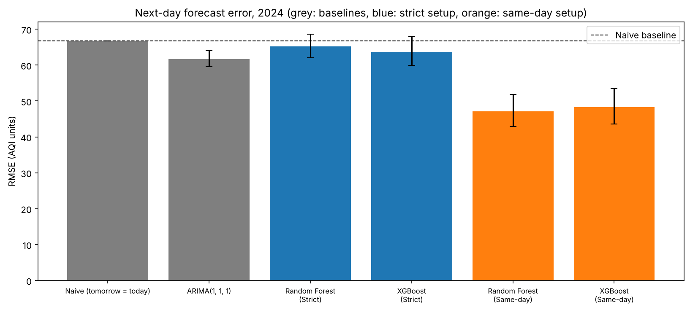

# AQI Estimation and Forecasting: Anand Vihar, Delhi

This project looks at five years (2020–2024) of daily air quality data from the Anand Vihar monitoring station in Delhi, one of the most polluted spots in the city. I asked two questions:

1. **Estimation:** if I know today's pollutant levels, how well can I work out today's AQI?
2. **Forecasting:** using only what is known before tomorrow, how well can I predict tomorrow's AQI?

These sound similar but they are different problems. CPCB calculates AQI directly from pollutant levels, so the first question is really about learning that relationship. The second question is about the future, and it turned out to be much harder.

## Data

The data comes from the [Central Pollution Control Board (CPCB)](https://cpcb.gov.in/index.php), Anand Vihar DPCC station, from 1 January 2020 to 31 December 2024 (1,827 days). It includes daily averages of pollutants, weather and AQI. About 13% of the AQI values are missing, and I never use filled-in AQI values to train or test the models.

The raw CSV files are not included in this repository. [`data/README.md`](data/README.md) explains where to download them.

## How I tested the models

- I trained on 2020–2023 and tested on 2024, so the models are always judged on a year they have never seen.
- Anything learned from the data (scaling, feature selection) comes from the training years only.
- Every forecasting model is compared with a simple baseline: "tomorrow's AQI = today's AQI". A model is only useful if it beats that.

## Key results

**Estimating today's AQI works well.** XGBoost reached R² 0.942 (RMSE 27.8) and Random Forest 0.939, using PM2.5, PM10, NO, NO₂, NOx and CO. PM10 and PM2.5 drive almost all of the predictions, which matches how CPCB calculates AQI.

**Forecasting tomorrow's AQI is much harder.** The daily AQI appears to cover a 4 PM-to-4 PM window, while the pollutant data runs midnight to midnight. So I only count forecasts that use pollutant and weather data from yesterday or earlier, which avoids any overlap with tomorrow's AQI period:

| Model (311 test days in 2024) | RMSE | Change vs "tomorrow = today" |
|---|---|---|
| Tomorrow = today (baseline) | 66.7 | |
| ARIMA(1,1,1) | 61.6 | −7.6% (clearly better) |
| Random Forest | 65.2 | −2.2% (not clearly better) |
| XGBoost | 63.7 | −4.6% (not clearly better) |

From this station's daily data alone, tomorrow's AQI is only a little more predictable than assuming it will be the same as today.

<p align="center">
  
</p>

**Full results, all figures and the limitations are in [results/README.md](results/README.md)**, including the timing check, the 30-day forecasting experiment, and data problems I found (unreliable wind direction data and a 174-day gap in toluene and benzene).

## How to run it

```bash
git clone <your-repo-url>
cd AQI-Estimation-and-Forecasting
pip install -r requirements.txt
```

1. Download the data as described in [`data/README.md`](data/README.md) and put the five CSV files in `data/`.
2. Run everything (takes about 2–3 minutes):
   ```bash
   python run_pipeline.py
   ```
   This recreates every table and figure in `results/`.
3. Optionally, run the tests :
   ```bash
   python -m pytest tests
   ```

## Project layout

```
AQI-Estimation-and-Forecasting/
├── data/                  How to get the data (raw files not included)
├── src/
│   ├── setup/             Settings, data loading, data checks, trend analysis
│   ├── utils/             Metric functions (metrics.py), saving tables and figures
│   ├── task1_estimation/  Feature selection, models, evaluation, plots
│   └── task2_forecasting/ Timing check, features, models, evaluation, plots
├── tests/                 Tests for the metrics and the forecasting features
├── results/               All outputs, with a full write-up in results/README.md
└── run_pipeline.py        Runs everything
```

The metric calculations (RMSE, MAE, R² and so on) live in one place, `src/utils/metrics.py`. Each task's `evaluation.py` decides what to score, and the results are saved as CSV files in `results/`.

## Reproducibility

Random seeds are fixed, so the results are the same every time. I ran the pipeline in a fresh copy of the project and all 16 output tables came out byte-for-byte identical, using Python 3.12, scikit-learn 1.9.1, XGBoost 3.4.1, statsmodels 0.15.0 and pandas 3.0.6. Other library versions may give slightly different numbers.

The tests check the metric functions (AQI category boundaries, RMSE and MAE values, the confidence-interval calculation) and confirm that the forecasting features never use data from the future.

## Author

**P B A Kushal**

Data: Central Pollution Control Board (CPCB), Government of India.
