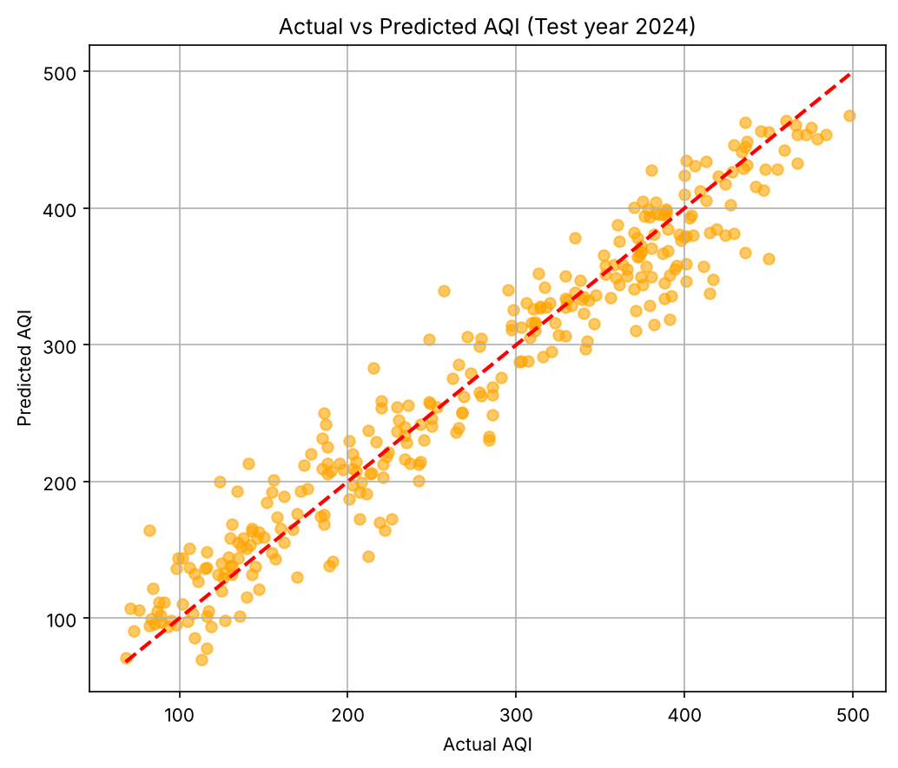
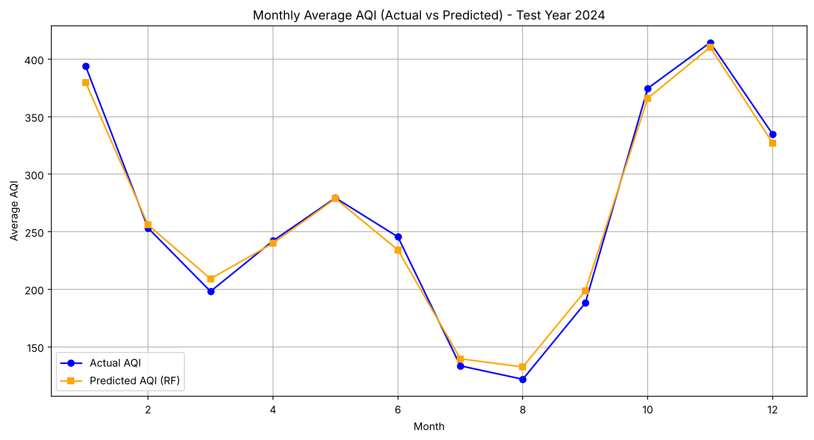
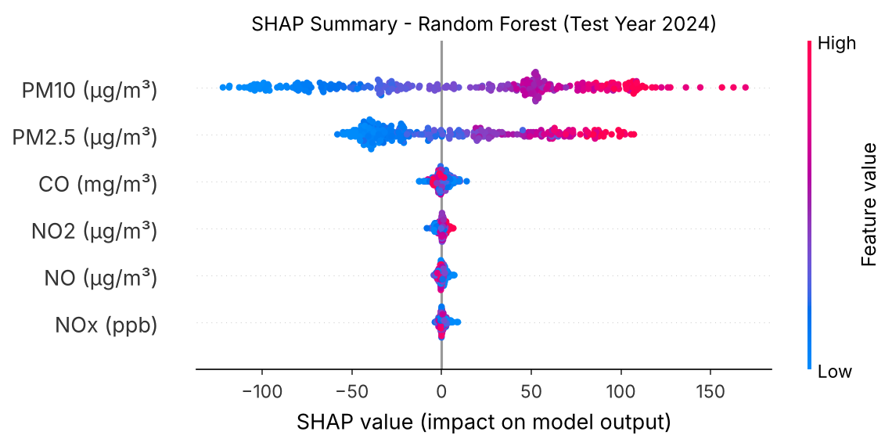
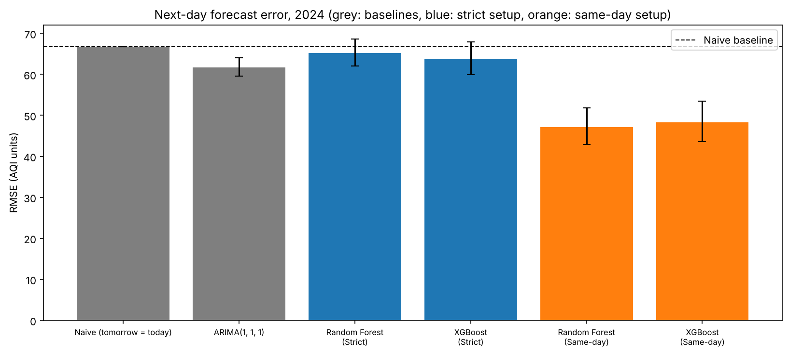
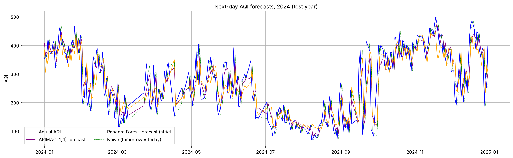
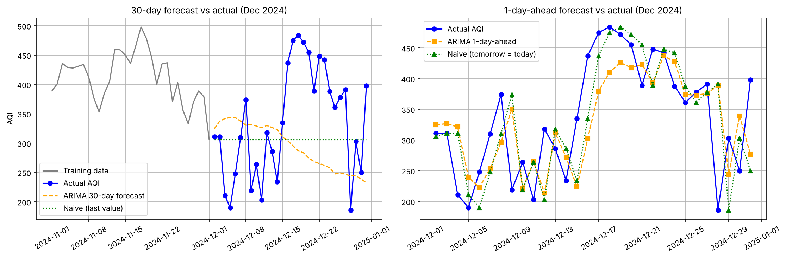
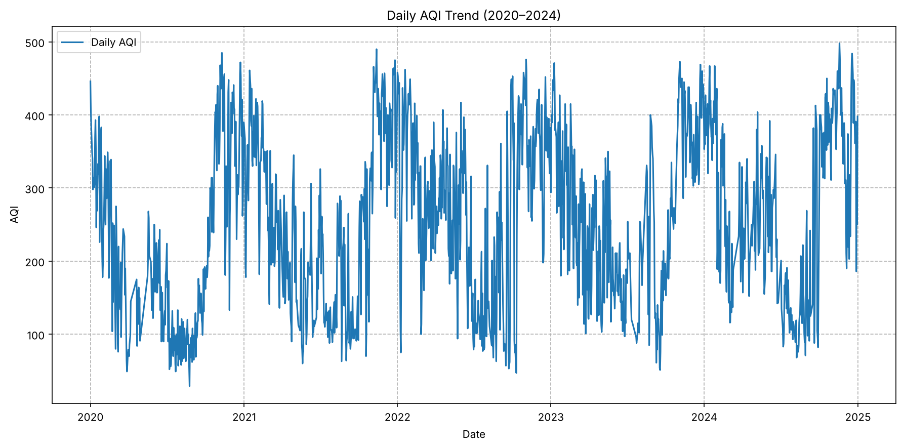
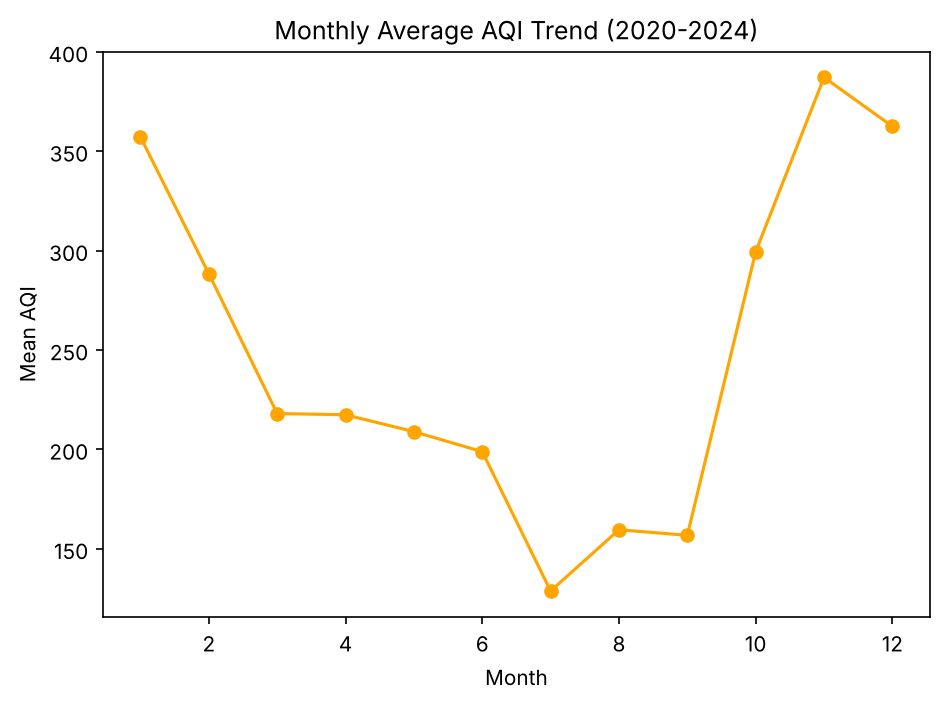

# Results

This page has the full results of the project. For an overview and how to run it, see the [main README](../README.md).

All results are on the 2024 test year, using only days where AQI was actually measured. Every number here comes from the CSV files in this folder, which `run_pipeline.py` regenerates:

- `metrics/`: main results for both tasks
- `explainability/`: SHAP tables (how much each input affects the predictions)
- `diagnostics/`: data checks, the leakage test and the timing check
- `predictions/`: day-by-day estimated AQI
- `figures/`: all plots, grouped by task

## Task 1: Estimating today's AQI

I used PM2.5, PM10, NO, NO₂, NOx and CO as inputs. These are the pollutants most strongly linked to AQI in the training years.

| Model | R² | RMSE | MAE |
|---|---|---|---|
| Linear Regression | 0.864 | 42.6 | 32.5 |
| Random Forest | 0.939 | 28.4 | 22.3 |
| XGBoost | 0.942 | 27.8 | 22.3 |

Random Forest and XGBoost work almost equally well, and both clearly beat linear regression. The AQI category (Good, Satisfactory, Moderate, Poor, Very Poor or Severe) was right on 75.9% of the measured 2024 days.

  
  

To see what the model relies on, I used SHAP, a method that shows how much each input pushes a prediction up or down. PM10 moves the estimate by about 65 AQI points on average and PM2.5 by about 40. The other pollutants add only 1–3 points each. That makes sense: at Anand Vihar, AQI is almost always set by PM10 or PM2.5.

  

## Task 2: Forecasting tomorrow's AQI

### A timing problem I had to check first

The pollutant values in the data are midnight-to-midnight averages. But CPCB's daily AQI bulletin comes out around 4 PM and covers the previous 24 hours. When I checked the data, about 29% of each day's AQI is explained by the *previous* calendar day's PM levels, which fits a 4 PM-to-4 PM window.

If that's right, today's pollutant averages already include about 8 hours of the period that tomorrow's AQI covers. A model using them would partly be looking at the answer. I can't confirm the exact definition from the daily data alone, so I tested two versions:

- **Strict:** pollutant and weather inputs from yesterday and earlier. No possible overlap. This is my main result.
- **Same-day:** pollutant and weather inputs from today. These may overlap with tomorrow's AQI period.

Both versions use AQI values up to today, and both pass a test confirming that no future days are used.

### Results (311 test days in 2024)

| Version | Model | R² | RMSE | MAE | Change in RMSE vs baseline |
|---|---|---|---|---|---|
| Baseline | Tomorrow = today | 0.665 | 66.7 | 47.7 | |
| Baseline | ARIMA(1,1,1) | 0.714 | 61.6 | 45.7 | −7.6% (−10.7% to −4.1%) |
| Strict | Random Forest | 0.680 | 65.2 | 49.0 | −2.2% (−7.0% to +2.9%) |
| Strict | XGBoost | 0.695 | 63.7 | 48.7 | −4.6% (−10.1% to +1.8%) |
| Same-day | Random Forest | 0.833 | 47.1 | 35.1 | −29.4% (−35.8% to −22.3%) |
| Same-day | XGBoost | 0.825 | 48.3 | 36.1 | −27.6% (−34.7% to −19.9%) |

The ranges in brackets are 95% confidence intervals. If a range crosses zero, the model can't be told apart from the baseline.

What this means:

- With strict timing, only ARIMA (a classic time-series model) clearly beats the baseline, and only by about 8%. Random Forest and XGBoost are not reliably better than "tomorrow = today".
- The same-day models look much better, about 29% better than the baseline. But they rely mostly on today's PM10 and PM2.5 rather than today's AQI, which is exactly what you'd expect if today's PM data overlaps tomorrow's AQI period. So I don't count this as real forecasting skill.
- My honest conclusion: from this station's daily data alone, tomorrow's AQI is only a little more predictable than simply assuming it will be the same as today.

  

  

### Extra experiment: forecasting a whole month ahead

My original version of this project used ARIMA to forecast 30 days ahead. When I tested it properly, by hiding December 2024 and comparing the forecast with what actually happened, it did worse than just repeating the last known value:

| Test | ARIMA(30,2,0) RMSE | Baseline RMSE |
|---|---|---|
| 30 days ahead | 120.3 | 96.3 |
| 1 day ahead | 78.0 | 78.2 |

December 2024 swung between AQI 186 and 484, and a model that only sees past AQI can't anticipate swings like that. This is why I switched the main forecasting task to next-day prediction.

  

## Other things I found in the data

- **Seasons:** AQI is worst in November–January (monthly averages of 357–386), when cold, still air traps pollution, and best in July–September (130–152), when monsoon rain clears it.
- **COVID year:** 2020 was the cleanest year, with an average AQI of 217 against 248–273 in the other years.
- **Wind direction data is unreliable:** almost no days (0.1%) show north-west winds, even though that's Delhi's main winter wind. It looks like hourly wind directions were averaged as plain numbers, which doesn't work for compass angles (350° and 10° are both roughly north, but their average is 180°, south). I left wind direction out ([figure](figures/diagnostics/03_wind_direction_check.png)).
- **Toluene and benzene have a long gap:** 174 days in a row are missing in 2023 (16 Feb – 8 Aug). Filling that gap ruins benzene's relationship with AQI (correlation drops from 0.60 to 0.03). Toluene made no real difference when I tested it within the training years, so I left it out too.

  
  

## Limitations

- **AQI time window not confirmed.** The 4 PM-to-4 PM window is my inference from the data. Hourly CPCB data would settle this and allow a proper forecast issued at a fixed time of day.
- **Looking back, not real time.** The archived data is cleaner than what's available live, when readings arrive late and sometimes get corrected.
- **One test year.** Everything is tested on 2024 only.
- **No weather forecasts.** The models use measured weather. Weather forecasts, crop-burning fire counts (NASA FIRMS) or mixing-height data (ERA5) would likely help.
- **One 30-day window.** The month-ahead experiment uses only December 2024.
